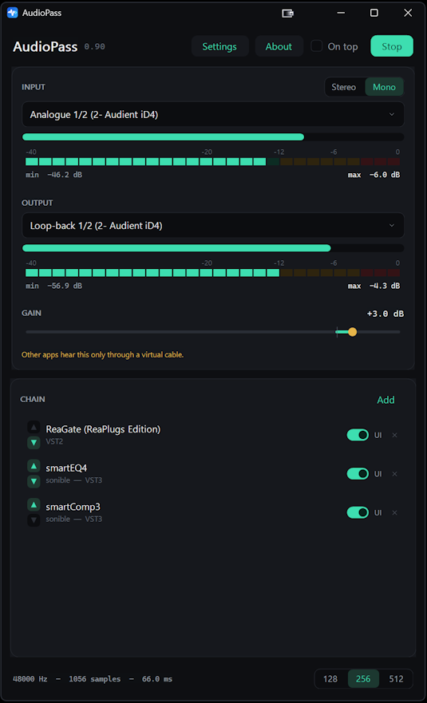

# AudioPass

AudioPass sends an input device through a chain of VST2 and VST3 plugins and writes the result to one output: a playback device or a WAV file. Other applications hear that output only through the device's loopback entry, for example "Loop-back 1/2 (loopback)" on an Audient iD4 or "CABLE Output" when using VB-Cable.



Plugins in the screenshot are examples only and are not included with AudioPass.

## Using AudioPass

Under **INPUT**, choose the microphone. **Stereo** keeps the two channels separate. **Mono** folds left and right into one signal and places it on both channels.

**OUTPUT** is the destination. Virtual outputs are listed first. **File** writes a WAV file, and the file name follows the arrow. Speakers can be selected, but they easily cause feedback. A yellow note appears when the output is not a virtual cable.

**Start** opens the route. **Stop** closes it. While the route is running, the bars show the peak level. Below them, a VU meter runs from −40 dB to 0 dB. **min** and **max** are the quietest and loudest values since the last start.

**GAIN** lowers or raises the output from −60 dB to +12 dB. Double-click returns it to 0 dB.

### Plugin chain

**Add** opens the plugin list. AudioPass scans the usual VST folders. More folders can be added there. A plugin file can also be dropped onto the window.

Order is the signal path from top to bottom. Drag a row to reorder it, or use the arrows on the row and the Up and Down keys while the list has focus. Delete or Backspace removes the selected entry. A click opens the editor when the plugin has one.

The buffer sizes **128**, **256**, and **512** samples sit at the bottom.

### Window and startup

**On top** keeps the window above the others.

**Settings** stores four switches:

- **Minimize to the system tray** hides the window in the notification area when it is minimized.
- **Minimize instead of quitting** turns the close button into minimize. With the tray option on, the window goes there.
- **Start with Windows** launches AudioPass when you sign in.
- **Start audio when AudioPass opens** presses Start after the chain has loaded.

While either of the first two options is on, the tray icon stays visible. A click brings the window back. Quit from the menu with **Exit**.

Size, position, and the other settings are stored in `%APPDATA%\AudioPass`. **About** shows the version and the VST notice.

## Building

AudioPass builds on Windows with Visual Studio 2026 and CMake. The first configure downloads wxWidgets 3.2.11 and the VST 3 SDK 3.8.1 into `third_party` when those directories are missing. Git is required for that download. The libraries are not part of the repository.

```bat
cmake -S . -B build -G "Visual Studio 18 2026" -A x64
cmake --build build --config Release
```

The executable is `build\bin\Release\AudioPass.exe`. The same steps are in `build-release.ps1` and `build-debug.ps1`.

## License

The AudioPass source is released under the [MIT License](LICENSE.md).

wxWidgets, the libraries built into it, and the VST 3 SDK keep their own licenses. The texts are in [THIRD-PARTY-NOTICES.md](THIRD-PARTY-NOTICES.md).

This software is based in part on the work of the Independent JPEG Group.

VST is a trademark of Steinberg Media Technologies GmbH, registered in Europe and other countries.
